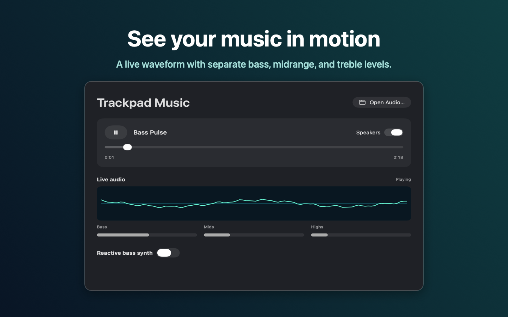

# Trackpad Music

Trackpad Music is a native macOS music player that lets you **see your music** and, with a compatible Force Touch trackpad and the direct build, **feel it**. Open a local audio file or browse the songs in your Mac’s Music library. For local playback, the app shows a live waveform, separates bass, midrange, and treble, and can blend in a reactive bass synthesizer.



## Get started

- **Open Audio…** (⌘O) opens a local MP3, WAV, M4A, AIFF, or another audio format macOS can decode.
- **Music Library** (⌘L) searches by title, artist, or album. Readable local files appear first. Uncheck **Show cloud songs** to see and play only local files.
- **Play Song** uses an unprotected local file when available. On macOS 14 or later, the app can stream eligible cloud and protected tracks through Apple Music. If a track’s local copy can’t be opened, playback can fall back to the cloud while **Show cloud songs** is checked.
- **Space** plays or pauses. Use the seek slider to move through the song. **Trackpad Music → Settings** (⌘,) opens the accessibility and playback preferences.

Local playback requires macOS 13 or later. Apple Music streaming requires macOS 14 or later, an internet connection, and permission to access your Music library. Some tracks require an Apple Music subscription.

## Two build variants

| Feature | Direct build | Mac App Store build |
| --- | --- | --- |
| Local audio and Music library search | Yes | Yes |
| Apple Music cloud playback | Yes, on macOS 14 or later | Yes, on macOS 14 or later |
| Live waveform, frequency meters, and reactive bass synth | Local files | Local files |
| VoiceOver announcements and optional numeric meters | Yes | Yes |
| Bass Boost, Third Speaker, and microphone feedback | Compatible Force Touch trackpad | — |

The sandboxed Store build uses public macOS APIs. The direct build uses a private macOS framework for the trackpad motor, so its haptic compatibility varies with hardware and macOS. Speaker playback works on Macs without compatible trackpads.

### Visual and tactile feedback

Turn on **Reactive bass synth** to blend an extra bass layer into local playback. **Synth mix** controls its level. In Settings, **Show numeric audio levels** adds percentages to the meters, and **Announce playback changes** lets VoiceOver announce the current song when playback starts or pauses. The seek slider exposes elapsed and total time to VoiceOver.

The direct build supports built-in Force Touch trackpads and compatible Magic Trackpad models. Choose **Bass Boost** for low frequencies or **Third Speaker** for a simplified mix of bass, mids, and highs. **Intensity** sets the strength. Turn **Trackpad output** to **Off** to stop the motor.

MusicKit cloud streams don’t supply audio samples to the waveform or trackpad engine. During cloud playback in the direct build, **Microphone feedback** can drive the trackpad from sound picked up near your Mac, including your speakers. It’s off by default, requires microphone permission, and stops when playback pauses or the player window closes. The microphone signal is processed live on the Mac without saving or uploading it.

## Build from source

Open [TrackpadMusic.xcodeproj](TrackpadMusic.xcodeproj) in Xcode, select your development team under **Signing & Capabilities**, and run one of these schemes:

- **TrackpadMusic** for the direct build with haptics.
- **TrackpadMusic-AppStore** for the sandboxed Mac App Store build.

To build the direct Release variant from the repository root:

```sh
xcodebuild -project TrackpadMusic.xcodeproj -scheme TrackpadMusic \
    -configuration Release -destination 'generic/platform=macOS' \
    CONFIGURATION_BUILD_DIR="$PWD/build" build
open "build/Trackpad Music.app"
```

For cloud playback in a build you make yourself, sign it with the team that owns its explicit bundle ID and enable the **MusicKit** app service for that ID in Apple Developer. This project’s configured bundle ID is `com.elliotwilliams.TrackpadMusic`. Sign in to Music and allow Media & Apple Music access when prompted. [Apple’s MusicKit setup guide](https://developer.apple.com/help/account/services/musickit/)

## Project and release materials

- [Store listing and screenshots](AppStore/Listing.md)
- [Mac App Store archive and submission steps](AppStore/Submission.md)
- [Privacy information](AppStore/Privacy.md)
- [Quick support guide](AppStore/Support.md)
- [Bass Pulse demo track](AppStore/Bass%20Pulse.wav)

The repository contains the Xcode project, source code, app icons, screenshots, and release materials. Xcode build output, signed installers, and local IDE settings stay in your workspace.

## Credits and feedback

Trackpad Music is a standalone project built from experiments in NoSpeaker Studio. Its trackpad motor code draws on [nospeaker by Cody Collier](https://github.com/os6/nospeaker). See the [upstream MIT notice](ThirdPartyNotices.md).

For a bug report or feature request, use [GitHub Issues](https://github.com/elliot7williams/Trackpad-Music/issues). For playback or trackpad bugs, include your macOS version, trackpad model, and whether you were playing a local file or a cloud song.
